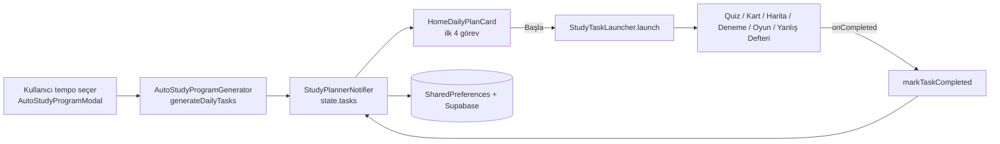

# Ana Sayfa Günlük Görevler (Bugünün Çalışma Planı)

Bu doküman, mobil ana sayfadaki **"Bugünün Çalışma Planı"** kartının nasıl çalıştığını anlatır: görevler nasıl üretilir, nasıl başlatılır, nasıl tamamlanır ve nasıl saklanır.

## 1. Genel Akış

## 2. İlgili Dosyalar

| Katman | Dosya | Görev |
|---|---|---|
| UI | `lib/features/planner/presentation/widgets/home_daily_plan_card.dart` | Ana sayfadaki kart (`HomeDailyPlanCard`) ve satır (`_DailyPlanTaskItem`) |
| UI | `lib/features/planner/presentation/study_task_launcher.dart` | Göreve tıklanınca doğru ekranı açar, bitince görevi tamamlar |
| UI | `lib/features/planner/presentation/study_planner_screen.dart` | "Tümünü Gör" tam planlayıcı ekranı |
| State | `lib/features/planner/data/study_planner_notifier.dart` | `StudyPlannerNotifier` (Riverpod), gün/görev durumu |
| Üretim | `lib/features/planner/data/services/auto_study_program_generator.dart` | Tempo ve güne göre görev listesi üretir |
| Model | `lib/features/planner/data/models/study_task.dart` | `StudyTask`, `StudyTaskActionType` |
| Model | `lib/features/planner/data/models/study_program_pace.dart` | `StudyProgramPace` (15/30/45/60/90 dk) |
| Depolama | `lib/core/services/local_storage_service.dart`, `lib/features/stats/data/cloud_sync_repository.dart` | Yerel kayıt ve bulut eşitleme |

## 3. Kartın Arayüzü

`HomeDailyPlanCard` yukarıdan aşağıya şunları gösterir:

1. **Başlık:** "Bugünün Çalışma Planı" + **Tümünü Gör** (tam `StudyPlannerScreen`'e gider).
2. **Özet satırı:** `Gün N` rozeti, geçmiş gün görüntüleniyorsa **Tekrar** rozeti, seçili tempo etiketi ve **Düzenle** (tempo/program modalı).
3. **İlerleme çubuğu:** `tamamlanan/toplam görev`. Hepsi bitince renk `secondary` olur.
4. **Görev satırları:** En fazla **ilk 4 görev** (`tasks.take(4)`). Görev yoksa "Planlanmış görev yok" mesajı çıkar.
5. **Gün geçiş butonları:** Aşağıda anlatılan kurallara göre görünür.

### Görev satırının iki dokunma alanı

- **Sol daire (checkbox):** `toggleTask(id)`, görevi elle tamamlandı / tamamlanmadı yapar.
- **Satırın geri kalanı:** `StudyTaskLauncher.launch(...)`, göreve ait oturumu açar. Sağda `Başla ›` yazar. Görev tamamlanmışsa `Tekrar` yazar. `custom` türündeki görevlerde bu etiket yoktur.

## 4. Görev Türleri (`StudyTaskActionType`)

| Tür | Açılan ekran | Hedef alanlar |
|---|---|---|
| `quiz` | `QuizScreen` (konu testi, 10 soru) | `targetTopic`, `targetTestNumber`, `targetCount` |
| `flashcards` | `FlashcardsScreen` | `lessonTag`, `startIndex`, `targetCount` (kart sayısı) |
| `map` | `MapChallengeScreen` (Günlük Harita Maratonu) | `targetCount` (hata olursa `MapPracticeHubScreen`) |
| `exam` | Deneme (`QuizScreen` veya `launchBlueprintExamWithGuard`) | `targetExamNumber` |
| `game` | `ConceptMatchScreen` | `startIndex` |
| `mistakes` | `MistakesScreen` | `targetCount` |
| `custom` | Sadece SnackBar gösterir | Kullanıcının elle eklediği görev |

Tüm ekranlara `onCompleted: markDone` callback'i verilir. Oturum bitince `StudyPlannerNotifier.markTaskCompleted(task.id)` çağrılır.

## 5. Görevler Nasıl Üretilir?

`AutoStudyProgramGenerator.generateDailyTasks(...)` girdileri: hedef sınav, **tempo (`StudyProgramPace`)**, odak ders, **gün numarası (`cycleDay`)**, müfredat ve sınav kapsamı (`examScope`).

### 5.1 Konu testleri (müfredat kuyruğu)

Önce müfredat sıralı bir test listesine çevrilir (`buildOrderedCurriculum`). Her gün bu listeden, kümülatif ofsete göre devam edilir. Ofset: `_cumulativeTestsBeforeDay`. Daha önce çözülmüş testler `isTestSolved` ile elenir.

Günlük test sayısı (`_testsCountForDay`):

| Tempo | Günlük test sayısı |
|---|---|
| 15 dk | 1 |
| 30 dk | 1 (her 3. gün 2) |
| 45 dk | 2 |
| 60 dk | tek günler 3, çift günler 2 |
| 90 dk | 3 (her 4. gün 2) |

### 5.2 Destekleyici görevler (tempoya göre)

| Tempo | Eklenen görevler |
|---|---|
| 15 dk | Tek günler 6 bilgi kartı, çift günler 4 soruluk harita |
| 30 dk | 10 kart + (çift günler harita, tek günler Yanlış Defteri) |
| 45 dk | Tek günler 12 kart, çift günler 5 soruluk harita |
| 60 dk | 15 kart + (3'ün katı günler Yanlış Defteri, çift günler Kavram Oyunu, diğerleri Harita) |
| 90 dk | 20 kart + her 4. gün **Deneme**, diğer günler Harita + Yanlış Defteri |

Bilgi kartı dersi, ders rotasyonuna göre döner: `lessonsOrder[(gün-1) % dersSayısı]`. Müfredat kart veya harita desteklemiyorsa yerine Yanlış Defteri tarzı çeldirici tekrarı konur.

### 5.3 Sprint Modu

`isSprintMode` açıksa ve günde deneme yoksa:

- Çift günlere **60 soruluk deneme** eklenir.
- Yanlış Defteri görevi yoksa **Sprint: Yanlış Defteri** eklenir.

Sınava 30 gün veya daha az kaldığında önerilir (`isWithinSprintWindow`).

## 6. Gün Sistemi ve Kilit Mantığı

`StudyPlannerState` alanları:

- `cycleDay`: ekranda görülen gün.
- `maxUnlockedDay`: kilidi açılmış en yüksek gün.

Kurallar:

- **Bugünün tüm görevleri bitmeden** yeni günün kilidi açılmaz (`canAdvanceToNextDay = allCompleted || cycleDay < maxUnlockedDay`).
- Hepsi bitince **"Günü Tamamladın! Sonraki Güne Geç"** (`advanceToNextDay`) butonu çıkar.
- Geçmiş bir gün görüntülenirken (`isViewingPastDay`) **"Sonraki Açık Güne Git"** ve **"Önceki Güne Dön"** (`goToPreviousDay`) butonları kullanılır.
- Her günün görevleri `_dayTasksCache[gün]` içinde saklanır, böylece gün geçişleri anlıktır.

## 7. Otomatik Tamamlanma

Görev üç yolla tamamlanır:

1. **Manuel:** sol daireye dokunmak (`toggleTask`).
2. **Oturum bitişi:** `StudyTaskLauncher` içindeki `onCompleted` (`markTaskCompleted`).
3. **Bağımsız çözüm:** Dersler veya Denemeler sekmesinden çözülen test, plandaki eşleşen görevi de tamamlar.
   - `markMatchingTestCompleted`: test bitince anında çalışır.
   - `syncCompletedFromStats`: `studyStatsProvider` değişince geçmiş oturumları tarar. Bulutla gelen veriyi de kapsar.

Eşleşme anahtarı: `ders + konu + test numarası` (deneme için `targetExamNumber`).

## 8. Tempo Değişince Ne Olur?

`adaptStudyProgramPace` ilerlemeyi korur:

1. Gün sayacı asla geriye düşmez.
2. Geçmiş günler tamamlanmış olarak mühürlenir.
3. Bugün tamamlanan görevler aynen kalır.
4. Eksik kalan quiz sayısı yeni tempoya göre tamamlanır. Daha önce çözülen testler tekrar çıkmaz.
5. Kullanıcının eklediği özel görevler (`_customTasksByDay`) korunur.

Sınav türü (`examScope`) değişince `adaptCurriculumScope` eski kapsamın planını arşivler. Kullanıcı eski kapsama dönerse arşiv geri yüklenir.

## 9. Telafi Modu (TASK-159)

- `missedDaysCount`: son planlı tarihten bugüne, **haftalık çalışma günlerine** göre kaç gün kaçırıldığını sayar.
- `applyCatchUpRebalance` → `rebalanceMissedTasks`:
  - Bugünün tamamlanmamış görevleri günlük sınıra (`tasksPerDay + 1`) kadar bugüne alınır.
  - Fazlası sonraki 4 güne dağıtılır (`horizonDays = 4`).
  - Hiçbir görev kaybolmaz. Artanlar ilk gelecek güne eklenir.

## 10. Kullanıcı Eklemeleri

- `addTask`: kullanıcı kendi görevini ekler. Görev `_customTasksByDay` içinde tutulur ve Supabase'e `insertStudyTask` ile yazılır.
- `pullUpcomingTaskToToday`: `previewUpcomingTasks` ile önizlenen sonraki 2 günün görevlerinden biri bugüne çekilir.

## 11. Kalıcılık ve Senkron

Her değişiklikten sonra `_persistAndSyncSnapshot()` çalışır:

- **Yerel:** `savePlannerSnapshot`, `savePlannerDayTasks`, `savePlannerCycleDay`, `savePlannerMaxUnlockedDay`. Hesaba göre anahtarlanır (`_accountKey`).
- **Bulut:** `CloudSyncRepository.syncPlannerSnapshot` ve görev bazında `updateStudyTaskCompletion`.
- **Açılış:** `main.dart` önceden yüklenmiş durumu `initialPlannerStateProvider` ile verir, ilk karede görev kartı hazırdır. Ardından `_loadFromStorage()` güncel veriyi sessizce yükler.
- Hiç dokunulmamış varsayılan görevler (`task_1..3`) boş snapshot olarak dışa aktarılır, buluta gereksiz veri yazılmaz.

## 12. Bilinen Sınırlar

- Kart yalnızca **ilk 4 görevi** gösterir. Fazlası için **Tümünü Gör** gerekir (60/90 dk tempoda ve Sprint Modunda 4'ten fazla görev olabilir).
- Otomatik eşleşme (`syncCompletedFromStats`) yalnızca **quiz** görevlerinde konu/test numarasıyla çalışır. Kart, harita, oyun ve Yanlış Defteri görevleri oturum bitişiyle veya elle tamamlanır.
- `exam` görevlerinde `targetExamNumber` sabit `1` üretilir. Her 4. günde aynı deneme numarası hedeflenir.

## 13. Web/Angular Karşılıkları

| Flutter / Dart | Web/Angular benzeri |
|---|---|
| `StudyPlannerNotifier` (Riverpod `Notifier`) | Store / Service + Signals |
| `StudyPlannerState` | Immutable store state |
| `HomeDailyPlanCard` | `<app-home-daily-plan-card>` bileşeni |
| `StudyTaskLauncher` | Router link + action dispatcher |
| `ref.watch` / `ref.listen` | `computed` / `effect` |
